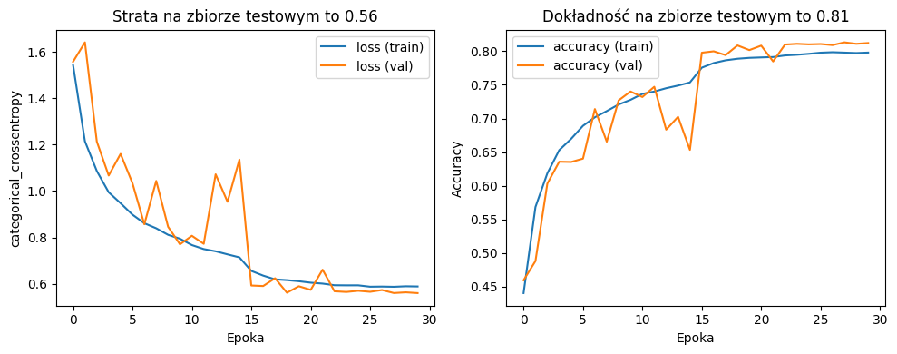
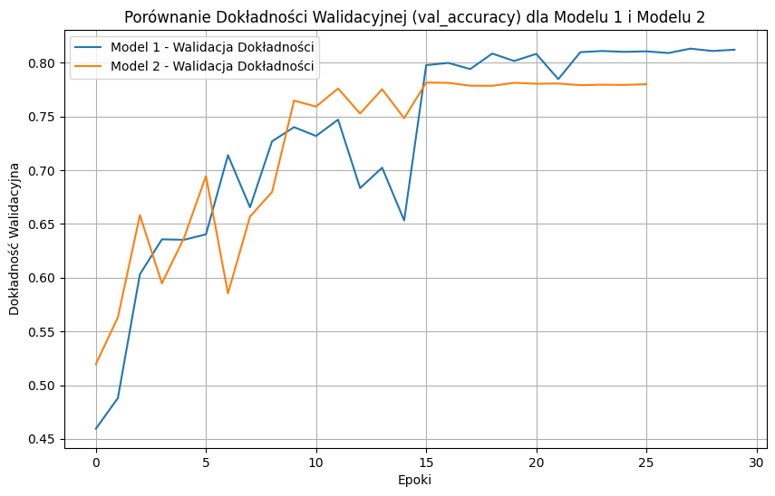
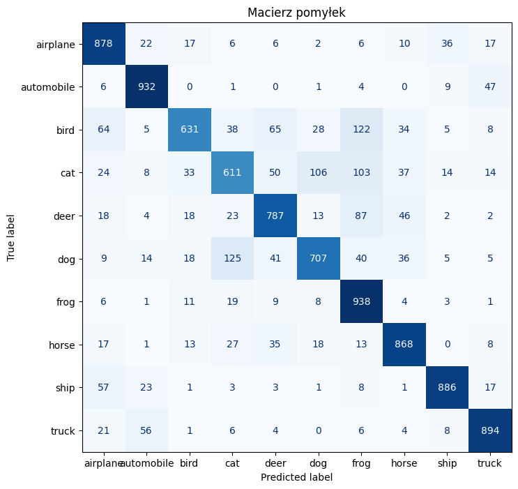

# Image recognition

| Project | Description | Stack |
|---|---|---|
| [`cifar-10.ipynb`](cifar-10.ipynb) | CIFAR-10 image classification (10 classes) with a CNN using BatchNorm, MaxPooling, GlobalAveragePooling and Dropout | Keras, NumPy, Matplotlib |
| [`camera_image_recognition/cnn`](camera_image_recognition/cnn) | Real-time object recognition from a camera (bottle, pen, flashlight) | PyTorch, OpenCV, Hugging Face `datasets` |

## CIFAR-10

A comparison of two small CNNs trained with data augmentation, `EarlyStopping` (patience 10, best weights restored) and `ReduceLROnPlateau`. Results come from `cifar-10.ipynb`; the test set is also used as the validation set:

| Model | Architecture | Parameters | Epochs | Accuracy (test) | Loss (test) |
|---|---|---|---|---|---|
| 1 | 3 Conv blocks (64-64-128), GELU | 131k | 30 | **0.81** | 0.56 |
| 2 | 5 Conv blocks (32-64-64-64-64), ReLU | 141k | 26 (early stopping) | 0.78 | 0.65 |

The shallower and wider network with GELU performed better than the deeper one, despite having fewer parameters.

Confusion matrix of model 1 on the test set (10,000 images, 8,132 correct). Cats and dogs are confused most often (106 cats predicted as dogs and 125 dogs as cats), as are birds and frogs (122 birds predicted as frogs). Frogs (938) and automobiles (932) are recognised best.

