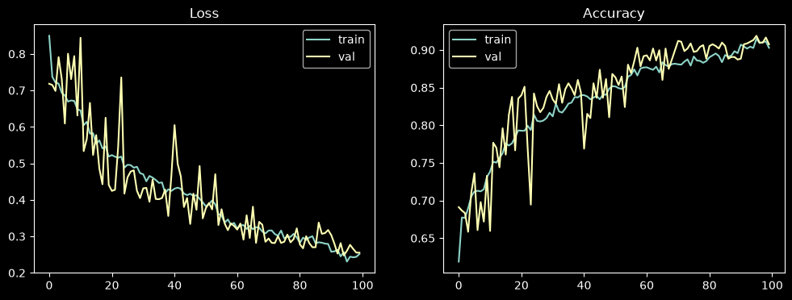
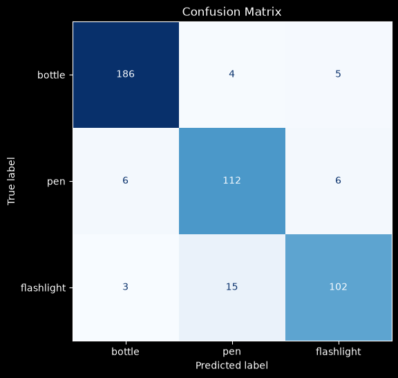

# Camera image recognition

Real-time object recognition from a camera (bottle, pen, flashlight).

- `model.ipynb`: loading the dataset (`imagefolder`), letterbox preprocessing (preserving the aspect ratio), CNN training (`SiLU`, `BatchNorm`, `Dropout`), confusion matrix.
- `main.ipynb`: loads the trained weights from `assets/best_model.pth` and classifies the camera image (`cv2.VideoCapture(0)`).
- Result of the best checkpoint (chosen by the lowest val loss) on the test set: **accuracy 0.911**, loss 0.225. The model's parameter size is 0.84 MB. Training ran for 100 epochs (Adam, lr 0.0012, `ReduceLROnPlateau` lowered the lr to 0.0006 and then to 0.0003).
- Dependencies are listed in `pyproject.toml` (Python ≥ 3.12, managed with [uv](https://docs.astral.sh/uv/)).

