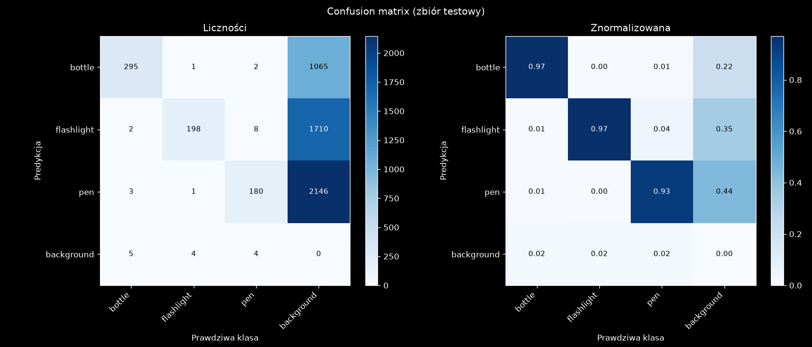
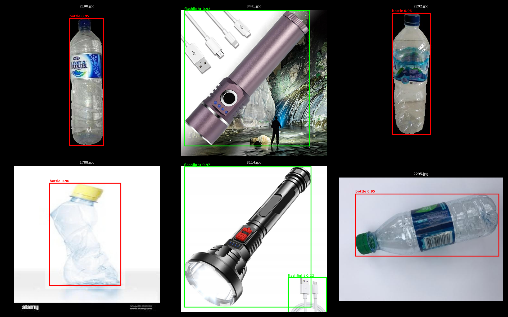

# Camera object detection (YOLO)

Real-time detection of a bottle, a flashlight and a pen from a camera. Unlike the [CNN version](../cnn/README.md), which assigns one class to the whole frame, this model finds every object and draws a bounding box around it.

- `json_to_yolo.py`: converts LabelMe / X-AnyLabeling annotations (JSON) to the YOLO format and splits the data into train/val/test (70/20/10, seed 42). It also writes `dataset.yaml`.
- `model.ipynb`: fine-tunes the pretrained `yolo26n.pt`, evaluates it on the test set, plots the confusion matrix and sample predictions, and saves the best weights as `best.pt`.
- `webcam.py`: live detection from the camera. Inference runs in a separate thread on every 3rd frame (input size 256, confidence threshold 0.2), and the image is shown with pygame because the OpenCV window did not display it. Run it with `python webcam.py [weights]` (default `best.pt`); `q` quits.

## Data

5,253 annotated images split into 3,677 train, 1,050 val and 526 test images. The images (`assets/`), the converted dataset (`dataset/`) and the pretrained weights (`yolo26n.pt`) are not in the repository.

### Converting annotations

`json_to_yolo.py` reads the `.json` files next to the images, turns every shape into a YOLO bounding box (`class x_center y_center width height`, normalised to 0–1) and copies the images into `dataset/images/<split>/`, with the labels in `dataset/labels/<split>/`. Rectangles, polygons and rotated boxes become the box that encloses their points, and circles the square around them. Points outside the image are clipped to its edges. Shapes with an unknown class, an unsupported type or an empty box are skipped with a message.

```bash
python json_to_yolo.py                                   # defaults: ./assets -> ./dataset, 70/20/10
python json_to_yolo.py -i ./assets -o ./dataset --classes bottle flashlight pen
python json_to_yolo.py --split train=0.8 val=0.2 --recursive --clean
```

| Option | Default | Meaning |
|---|---|---|
| `-i`, `--input` | `./assets` | Directory with the images and `.json` files |
| `-o`, `--output` | `./dataset` | Output dataset directory |
| `-c`, `--classes` | detected from the annotations, sorted | Class list; the order sets the class ids |
| `-s`, `--split` | `train=0.7 val=0.2 test=0.1` | Splits as `name=fraction`; fractions that don't sum to 1 are normalised |
| `--seed` | `42` | Random seed for shuffling before the split |
| `--yaml` | `./dataset.yaml` | Where to write `dataset.yaml` |
| `--no-yaml` | off | Don't write `dataset.yaml` |
| `-r`, `--recursive` | off | Search for `.json` files in subdirectories too; output names get the subdirectory path as a prefix so they don't collide |
| `--clean` | off | Remove `images/` and `labels/` from the output directory first |
| `--skip-missing` | off | Skip annotations without a matching image (by default the label file is still written) |

The split names are free-form, so `--split train=0.8 val=0.2` gives a dataset without a test set. The last split takes the remainder, so no files are lost to rounding.

## Training

YOLO26n (2.4M parameters after fusing, 5.4 GFLOPs), images resized to 256 px, AdamW (lr 5e-4, weight decay 1e-4), batch 16, `torch.compile`. It ran all 80 epochs (early stopping with patience 10 did not trigger) in 31 minutes on an AMD Radeon GPU (ROCm). The weights file `best.pt` is 5.2 MB.

## Results

Test set (526 images, 703 objects):

| Class | Images | Objects | Precision | Recall | mAP50 | mAP50-95 |
|---|---|---|---|---|---|---|
| bottle | 238 | 305 | 0.957 | 0.934 | 0.966 | 0.918 |
| flashlight | 150 | 204 | 0.885 | 0.868 | 0.921 | 0.859 |
| pen | 140 | 194 | 0.874 | 0.861 | 0.903 | 0.789 |
| **all** | 526 | 703 | **0.905** | **0.888** | **0.930** | **0.855** |

The bottle is detected best (the biggest dataset). The pen is the hardest: it has the lowest mAP50-95, so its boxes are the least precise, which is expected for a thin, elongated object.

The model rarely mixes up the classes: 673 of 703 objects are assigned the correct class, 17 get the wrong one (most often a pen predicted as a flashlight, 8 times, those are somewhat similar objects when it comes to how they loook) and 13 are not detected at all.




## Dependencies

Listed in `pyproject.toml` (Python >= 3.12, managed with [uv](https://docs.astral.sh/uv/)). PyTorch is installed from the ROCm 7.2 index (AMD GPU). For an NVIDIA GPU or CPU, change the `torch` and `torchvision` sources and remove `triton-rocm`.
