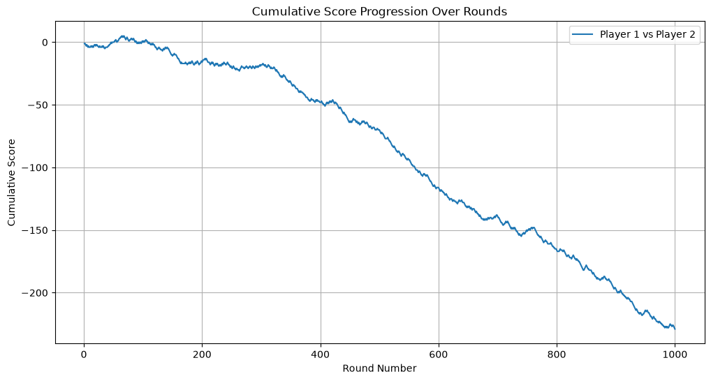

# Markov chains: rock-paper-scissors

The `MarkovPlayer` class plays according to a given transition matrix. `BayesianLearningPlayer` learns this matrix from the opponent's observed moves (counts with a Dirichlet prior) and predicts the next move. Code: [`markov_chain_rps.ipynb`](markov_chain_rps.ipynb).

Result of a single simulation (1000 rounds, `alpha=1.0`): the learning player won 477 rounds, lost 248, and 275 ended in a draw. The final score from the Markov player's perspective is −230. For the first 100 rounds the score hovers around 0, between rounds 175 and 300 it stays at around −20, and after that the learning player's lead grows almost linearly. The learned transition matrix is close to the given one (e.g. after `S` the opponent plays `R` with probability 0.79, against 0.8 in the given matrix).

Notation: R is rock, P is paper, S is scissors. The row is the opponent's previous move and the column is the next one.

| After move | R | P | S |
|---|---|---|---|
| R | 0.31 | 0.38 | 0.32 |
| P | 0.41 | 0.16 | 0.43 |
| S | 0.79 | 0.12 | 0.09 |

The result depends on randomness (no fixed seed), so later runs will give different numbers.
